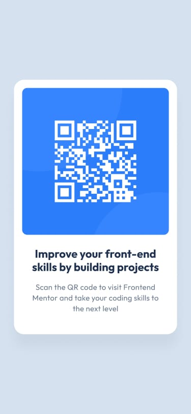

# Frontend Mentor - QR code component solution

This is a solution to the [QR code component challenge on Frontend Mentor](https://www.frontendmentor.io/challenges/qr-code-component-iux_sIO_H). Frontend Mentor challenges help you improve your coding skills by building realistic projects. 
 
## Table of contents

  - [Screenshot](#screenshot)
  - [Links](#links)
  - [Built with](#built-with)
  - [What I learned](#what-i-learned)
  - [Continued development](#continued-development)
  - [Useful resources](#useful-resources)
  - [Author](#author)


### Screenshot





### Links

- Solution URL: [Add solution URL here](https://your-solution-url.com)
- Live Site URL: [Add live site URL here](https://your-live-site-url.com)


### Built with

- Semantic HTML5 markup
- CSS Flexbox
- Desktop-first workflow


### What I learned

there were so many new feature on each of the the languages i have used and you can try to make a design in many ways 

```css
.main {
  display: flex;
  justify-content: center;
  align-items: center;
}

```
this part is the main gamechanger for me after this all i have to do was just changing the appereance and adjusting some margins.


### Continued development

I want to explore areas like css media queries and also how contents overlap like their placement with css grid and flexbox and also like animation effects like transitions and such i want to explore that area more also in this project i didn't use javascript and i would like to include and learn it in the upcoming projects i am going to do.


### Useful resources

- (https://www.freecodecamp.org/) - this website helped me in teaching about css flex and how you can position the div blocks with examples. 

## Author

- Frontend Mentor - [@ane1897-dev](https://www.frontendmentor.io/profile/ane1897-dev)


